<!-- Banner -->

  

<!-- Typing animation -->

  

<!-- Action buttons -->

  
  
  

  
  

---

## About Me

I'm a **Computer Science student** at The Superior University, Lahore, and a **full-stack developer** building web applications with **ASP.NET Core, Angular, React, and Node.js**.

During my internship at the **Punjab Information Technology Board (PITB)**, I designed and built **RestaurantOS**, a multi-tenant restaurant SaaS/POS, working across the database, APIs, and frontend.

**What I work with**
- Secure REST APIs with JWT authentication and role-based access control (RBAC)
- Multi-tenant architecture with tenant-level data isolation
- Relational database design on SQL Server, PostgreSQL, and MySQL
- Responsive UIs with Angular, React, and Tailwind CSS

---

## How I Build

  

---

## Tech Stack

  

  

  Also: SQL Server &bull; Entity Framework Core &bull; Swagger &bull; SSMS

---

## Featured Projects

### RestaurantOS &mdash; Multi-Tenant Restaurant SaaS/POS
*Built during my internship at PITB*

A cloud-based platform that lets multiple restaurants and branches run their operations from one system.

- Designed and built tenant-level data isolation so each restaurant's data stays separate and secure
- Branch-scoped modules: POS, Orders, Inventory, Staff, Dashboard, and Reports
- JWT claims, RBAC, and a layered Controller-Service-Repository architecture

> Private repository. Demo and walkthrough available on request.

---

### DriveEase &mdash; Car Rental Management System

A full-stack car rental platform with separate Admin and Customer access.

- Full booking lifecycle: browse, request, admin review, approval, and cancellation, with availability tied to booking state
- JWT authentication with role-based authorization
- Responsive dashboard for vehicles, bookings, and customer operations

> Private repository.

---

### ThreeMindSolution &mdash; Software House Website

A responsive multi-page website for a software company concept: Home, Services, Products, Projects, and Contact Us.

- Clear navigation to explore services, products, and portfolio work
- Responsive layout for desktop and mobile

---

### [Library Management System](https://github.com/Tayyab0505/Library_Management)

A full-stack library application with Admin and Student roles.

- Book inventory, borrow and return workflow, availability tracking, and borrowing history
- Authenticated, role-based access on a relational MySQL schema

  <a href="https://tayyab-shakeel.vercel.app/"><b>See screenshots and more details on my portfolio &rarr;</b></a>

---

## Currently Focusing On

- Advanced ASP.NET Core and Angular architecture
- Containerization and automated testing
- Database design and clean, maintainable code

## Open To

- Junior Full-Stack Developer roles (.NET / Angular / React)
- Collaborative projects and freelance opportunities

---

  <b>Let's connect and build something great.</b>

  

